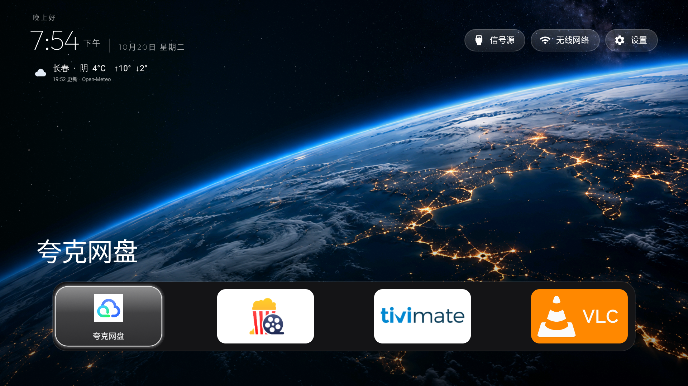
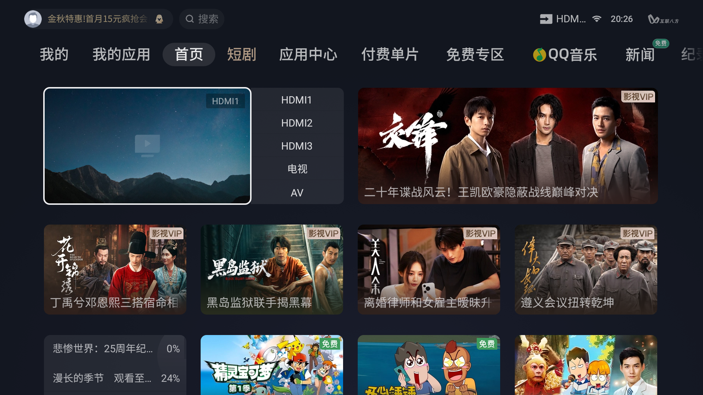

# CleanTCLTV-zh

基于 [Gathin23/cleanyourtv](https://github.com/Gathin23/cleanyourtv) 的国内 TCL 电视适配版本：普通应用桌面、原厂主页跳转、信号源入口、自选城市天气及地球壁纸。无需 Google 服务框架、root 或刷机。

## 原仓库与本适配版，应该选哪个？

| 电视情况 | 建议 |
|---|---|
| 能安装第三方桌面，并能正常设为默认 HOME | 优先参考上游 [Gathin23/cleanyourtv](https://github.com/Gathin23/cleanyourtv)，按原项目文档核对型号、系统和操作步骤。 |
| TCL 固件拒绝第三方 HOME 应用，或无法切换默认主页，但允许普通应用和无障碍服务 | 可考虑本项目 `CleanTCLTV-zh`，先核对下方适用条件及实测范围。 |
| 是否受限尚不清楚 | 先识别型号、Android 版本、原主页和安装策略，不应仅凭“TCL”品牌认定必须使用本适配版。 |

本项目是在上游基础上针对本次国内 TCL 固件限制所做的适配。没有这类限制时，可以优先采用原项目的默认桌面方案；不需要为了使用简洁桌面而额外引入本项目的主页跳转。原项目是否适用于具体设备，仍以其当前文档和实机验证为准。不要同时启用两套主页接管机制。

## 安装前：适用条件

| 条件 | 要求与限制 |
|---|---|
| 最低 Android 版本 | **Android 8.0 / API 26**（源码 `minSdk 26`）；低于此版本无法安装。 |
| 实测范围 | **TCL 85Q10G、Android 9、TVOS-04.16.031.01.12**。其他型号/版本未验证，Android 8+ 只是安装门槛，不是兼容保证。 |
| 适用的 TCL 限制 | 固件禁止第三方 HOME 桌面，或不能正常切换默认主页，但仍允许安装普通应用并运行无障碍服务。本方案通过跳转打开普通应用。 |
| 安装途径 | 需要可用的普通应用安装途径。文档使用已授权的 ADB；普通安装被禁时，备用 session 方式仅在上述 Android 9 固件验证，不能保证绕过其他固件限制。 |
| 自动主页跳转 | 必须能够开启并保持 TCL 跳转无障碍服务。默认识别 `com.tcl.cyberui/.MainActivity`；不同原主页需修改适配。不开启时只能手动打开本应用。 |
| 开机与后台 | 固件必须允许本应用自启动、关联启动及后台运行；通常需在 TV 卫士设置。无法取得这些权限时，不保证开机进入或持续跳转。 |
| 信号源与设置 | TCL 专用入口依赖固件提供对应组件；其他型号需要实测，不能保证 HDMI 菜单、Wi-Fi 和设置入口全部可用。 |
| 网络与天气 | 天气及城市搜索需要能访问 Open-Meteo；不能访问时影响天气，不阻止桌面使用。电脑安装时需能连接电视 ADB。 |
| Google / root / AI | **不需要 Google 服务框架、root、刷机或 AI 持续运行。** AI 仅为可选安装/适配助手。 |

**不适用或需要进一步适配：** Android 低于 8.0；固件完全阻止普通应用安装；无法启用无障碍服务却希望自动跳转；原主页或系统接口与实测设备不同。能够安装 APK、手动打开桌面，与自动跳转、自启动及信号源全部可用是不同的验证阶段。

这是保留原厂主页的可恢复方案。无法保证冷启动无闪现，也不会把国内固件变成 Google TV。详细步骤见 [构建与安装](docs/INSTALL.md)。

## 原厂主页与新桌面对比

以下均来自本次 TCL 85Q10G 实机，原厂主页保留启用。新桌面截图为电视已安装的 2.0 版长春配置示例；源码 2.1 版已改为用户自选天气城市，尚未补拍该界面。

| 原厂主页 | 新桌面 |
|---|---|
|  |  |

更多 [实机截图：应用焦点、信号源菜单及自启动权限](docs/SCREENSHOTS.md)。

## 工作方式与限制

部分 TCL 固件拒绝安装声明 HOME 类别的第三方桌面。本版本只声明普通应用入口，保留原厂主页。用户开启 TCL 无障碍跳转服务后，监听 `com.tcl.cyberui.MainActivity` 的窗口事件并打开新桌面；开机广播辅助启动。

**这是主页跳转方案，并非替换系统默认桌面。冷启动仍可能短暂显示原厂主页，无法保证消除闪现。** 固件升级、后台策略和无障碍绑定时间都可能影响结果。不应通过删除原厂主页来追求无闪现。

## 本次修改

- 普通应用安装；TCL 主页跳转、节流与循环保护、开机启动。
- 调用 TCL 原生信号源菜单，支持选择 HDMI/AV；修复无线网络及系统设置入口。
- 地球静态壁纸、暗部遮罩、大时钟和遥控器应用栏。
- 自选城市天气：当前天气、温度和当日最高最低温，30 分钟刷新，断网缓存与更新状态。
- 同时发现 TV 与普通应用入口；默认展示夸克网盘、网易爆米花、TiviMate、VLC，需分别安装。

不包含第三方 APK、直播源、账号或影视服务器地址。播放器能否解码取决于播放器版本、片源和电视硬件。

## 已验证设备

| 项目 | 实测环境 |
|---|---|
| 型号 | TCL 85Q10G |
| 系统 | Android 9 / API 28 |
| 内部标识 | tcl_m7642 |
| 固件 | TVOS-04.16.031.01.12 |
| ABI | armeabi-v7a / armeabi |
| 原厂主页 | com.tcl.cyberui/.MainActivity |

上述设备验证了安装、主页跳转、自启动、设置、信号源和天气。其他 TCL 型号及 Android 版本尚未验证，不能仅凭品牌判断兼容。最低安装版本为 Android 8，不代表所有 Android 8+ 固件均可使用。

## 开始使用

阅读 [构建与安装](docs/INSTALL.md)，先安装并手动打开，确认界面和遥控器正常，再开启无障碍跳转与 TV 卫士自启动权限。出现问题按 [恢复说明](docs/RECOVERY.md) 关闭跳转。

## 自定义

- 应用栏：修改 `launcher/app/src/main/res/values/config.xml` 的 `dock_apps` 和 `visible_apps`。后者非空时只显示名单中的已安装应用，清空数组则显示所有符合条件的应用。安装新应用不会自动加入非空名单。
- 天气：遥控器选中主页左上角天气区域，按确定，输入城市名搜索，核对省份/国家后选择保存。支持中文或拼音/英文查询；首次使用不默认长春。可清除城市以停止天气请求。天气缓存按城市隔离，使用 [Open-Meteo](https://open-meteo.com/)，城市数据来自 GeoNames；查询失败可稍后重试。公开运营前请核对服务条款。
- 壁纸：替换 `launcher/app/src/main/res/drawable-nodpi/earth_wallpaper.png`，这是本次 AI 生成的地球静态图，非 Apple 官方壁纸或视频屏保。
- 适配其他固件：同时检查 `TclHomeRedirectService.java` 和 `res/xml/tcl_home_redirect_service.xml` 中的主页包名、Activity；设置/信号源接口在 `MainActivity.java` 与 `config.xml`。

## 上传与来源

这是基于上游的独立适配仓库，不含完整上游 Git 历史。希望发布到自己账号的用户可参考 [上传 GitHub](docs/PUBLISH.md)。

基线上游提交：`7377a9be8ca0b33af6fea006230414582fd150bd`。软件沿用 [MIT](LICENSE)，保留 Gathin 原作者署名；Outfit 字体遵循 [SIL OFL 1.1](launcher/FONT-LICENSE-OFL.txt)。保留上游 banner 和图标；地球壁纸为本次生成素材，截图为本次实机界面。

天气城市由用户选择，无需获取当前位置；搜索文字将发送给 Open-Meteo 城市查询服务。无障碍服务不请求读取窗口内容。应用没有新增遥测后端；天气请求发送至 Open-Meteo。上游保留了用于部分系统读取 Wi-Fi 名称的定位权限声明，本次安装不需要授予该权限。

## 是否需要 AI

电视日常运行不需要 AI，也不需要 AI 账号或 API Key。AI 是可选的安装/适配助手：可以帮助检查型号、分析固件限制、构建、安装和排查问题。用户也能独立按文档完成。见 [AI 辅助安装指南](docs/AI-GUIDE.md)。

**不限于 Codex：WorkBuddy 等能够访问本地文件、执行终端命令并通过 ADB 连接电视的智能体，也可按文档协助。** 需配置相应权限与工具；其他智能体的完整流程尚未逐一实测，纯聊天或无法访问电视局域网的模式不能直接代为操作。
