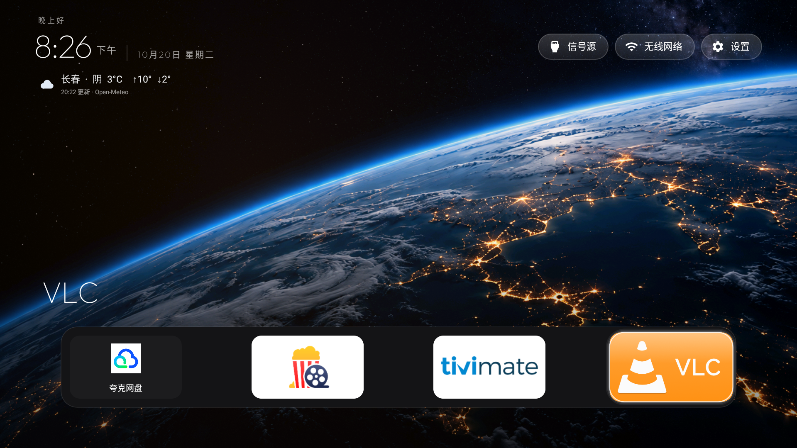
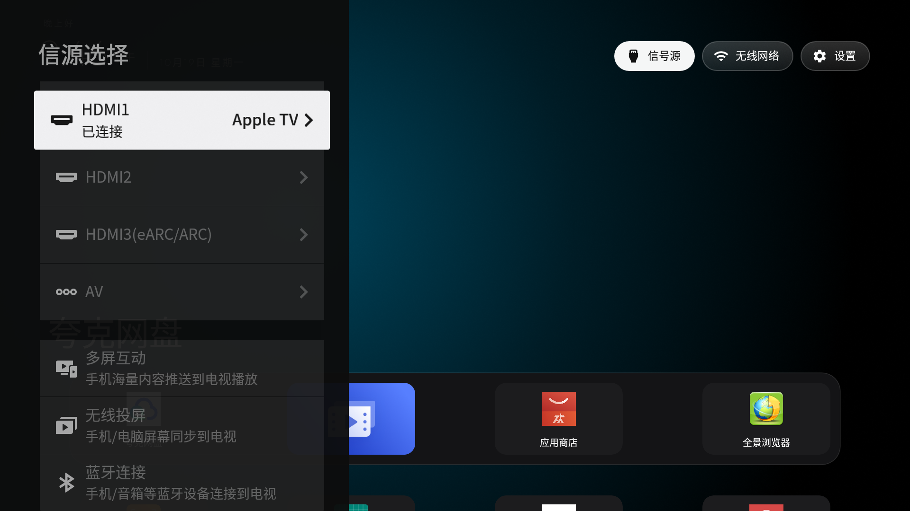
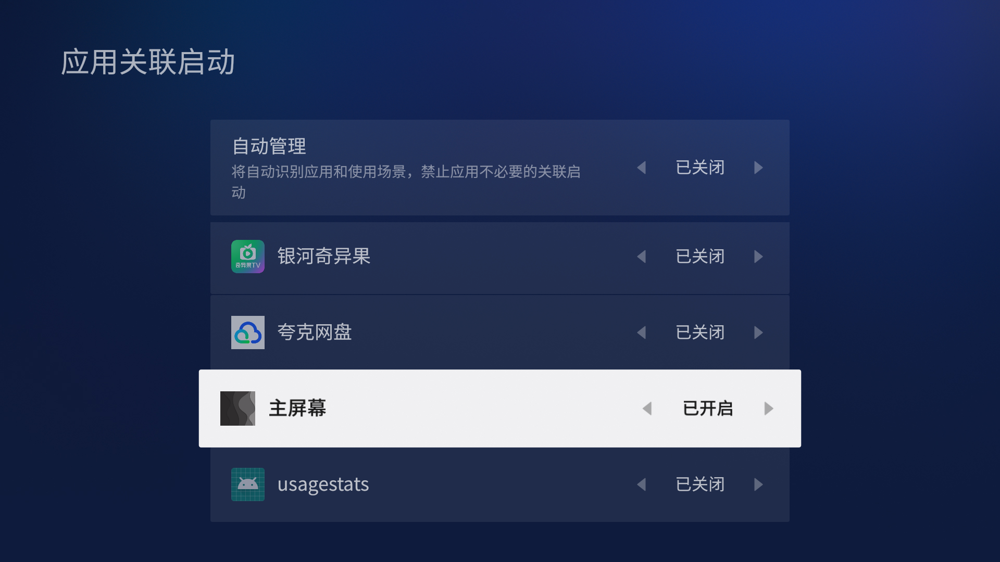

# TCL 85Q10G 实机截图

截图来自本次实测电视，未采用其他型号或上游仓库的桌面图片。原厂主页截图为保留原厂桌面、已完成此次适配及部分应用停用后的状态，并非恢复出厂设置的状态。内容推荐随时间变化。

## 原厂主页

保留影视推荐、原生 HDMI1/2/3、电视和 AV 入口。新桌面通过跳转打开，没有删除原厂主页。

## 新桌面：地球壁纸、天气和应用栏

## 新桌面：遥控器选中 VLC

以上新桌面截图为电视当前安装的 2.0 版，天气已配置为长春。仓库 2.1 版支持用户搜索和选择城市，尚未补拍城市选择界面，不应把旧截图作为新版设置界面的验证。

## 原生信号源菜单

由新桌面的“信号源”入口打开 TCL 原生菜单。这张截图摄于较早适配阶段，背景尚未换成地球壁纸。

## TV 卫士：允许关联启动

示例中“主屏幕”开启关联启动，自动管理关闭。设置路径及显示因固件而异，其他应用不必照搬截图设置。

原厂界面、影视海报及第三方应用图标用于展示实际兼容和操作效果，相关内容及标识属于各自权利人，不作为项目原创素材授权。
